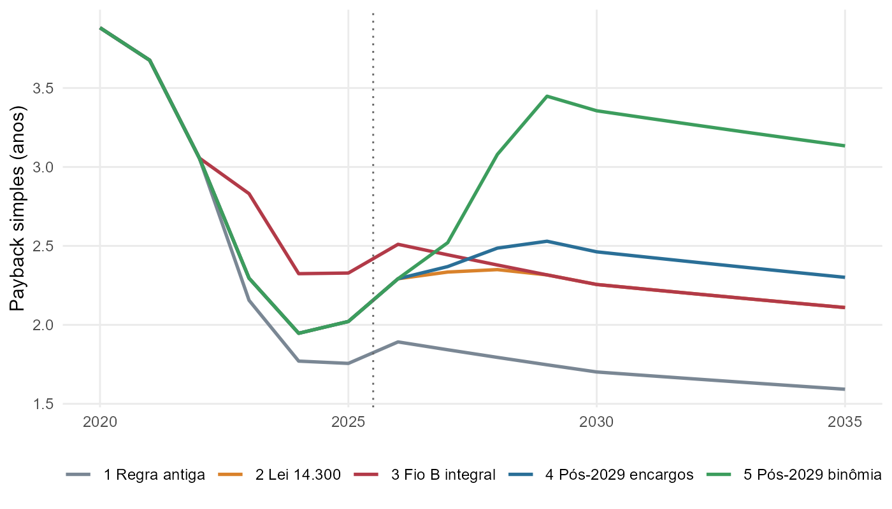
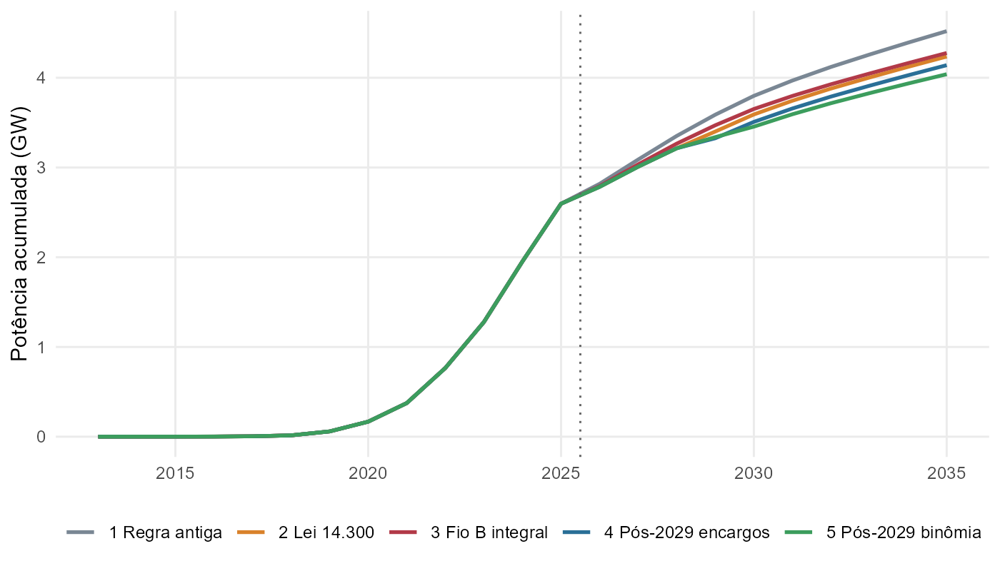
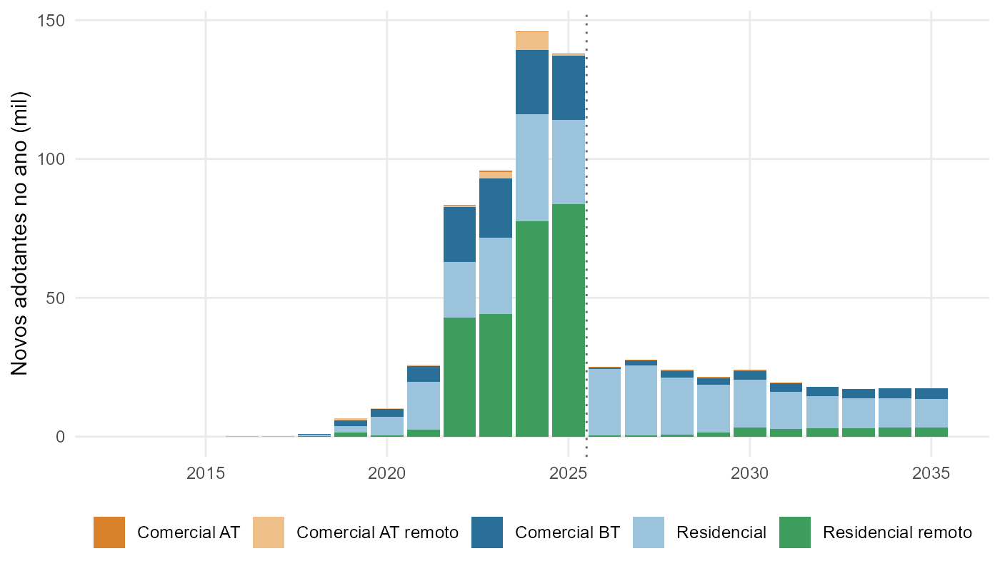
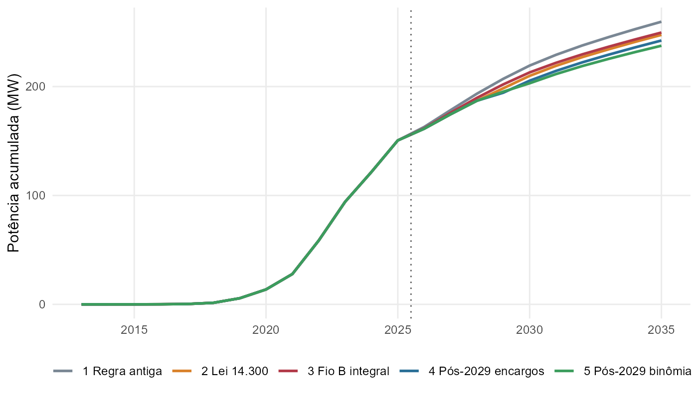

^1^ Discente de [curso], [Universidade]. ^2^ Docente de [departamento], [Universidade]. Trabalho de Iniciação Científica.

**RESUMO**

A micro e minigeração distribuída (MMGD) cresceu rapidamente no Brasil, e a Lei nº 14.300/2022 mudou as regras de compensação de energia. Este trabalho aplica o modelo 4MD, desenvolvido pela Empresa de Pesquisa Energética (EPE) para projeções nacionais, a um recorte regional: o estado da Bahia (área de concessão da Coelba) e o município de Salvador. Foram simulados cinco cenários regulatórios, da regra anterior à lei até cenários mais restritivos pós-2029, com cálculo do *payback* e da taxa interna de retorno por segmento de consumidor e projeção de adotantes, potência instalada e geração até 2035. Salvador foi estimada a partir da participação histórica do município na MMGD baiana (base de dados abertos da ANEEL). Os resultados indicam que o investimento residencial em sistemas fotovoltaicos continua atrativo em todos os cenários, com *payback* de 1,7 a 3,4 anos em 2030, conforme o cenário. A Lei 14.300 reduz a capacidade projetada para a Bahia em 2035 em cerca de 6% em relação à regra antiga (4,24 GW contra 4,52 GW), e a adoção de tarifa binômia na baixa tensão produziria o maior impacto (4,04 GW). Salvador, com cerca de 151 MW em 2025, chegaria a aproximadamente 247 MW em 2035. O trabalho também discute limitações da regionalização do modelo, em especial a saturação do mercado potencial da geração remota.

**Palavras-chave:** geração distribuída; energia solar fotovoltaica; Lei 14.300; *payback*; modelo de Bass.

**ABSTRACT**

This study applies EPE's 4MD diffusion model to the state of Bahia and the city of Salvador (Brazil), comparing five regulatory scenarios for net-metering compensation under Law 14,300/2022. Residential photovoltaic systems remain attractive in all scenarios (1.7–3.4-year payback in 2030). The new law reduces projected 2035 capacity in Bahia by about 6% compared to the previous rule, while a two-part low-voltage tariff would have the largest effect. Salvador is projected to reach about 247 MW by 2035.

**Keywords:** distributed generation; solar photovoltaics; net metering; payback; Bass model.

# 1 INTRODUÇÃO

A micro e minigeração distribuída (MMGD) permite que o consumidor produza a própria energia, geralmente com painéis fotovoltaicos, e compense o excedente injetado na rede. No Brasil, o sistema de compensação criado pela Resolução Normativa ANEEL nº 482/2012 impulsionou um crescimento acelerado do segmento, que ultrapassou dezenas de gigawatts de potência instalada na década de 2020.

Em 2022, a Lei nº 14.300 instituiu o Marco Legal da Geração Distribuída. Para os sistemas que solicitaram conexão a partir de 2023, a lei passou a cobrar de forma escalonada a componente de distribuição da tarifa (o chamado "Fio B") sobre a energia compensada, e previu a revisão das regras após 2029. Essas mudanças alteram o retorno financeiro de quem investe e, por consequência, o ritmo de adoção.

Para apoiar o planejamento energético, a Empresa de Pesquisa Energética (EPE) desenvolveu o modelo 4MD, que projeta a difusão da MMGD e de baterias atrás do medidor no Brasil e é publicado como pacote aberto em linguagem R (EPE, 2025). O modelo foi construído para o horizonte nacional e é usado nos Planos Decenais de Expansão de Energia.

Este trabalho tem dois objetivos: (i) avaliar como o modelo se comporta em um recorte territorial menor, o estado da Bahia e o município de Salvador; e (ii) relacionar as mudanças regulatórias da MMGD com a viabilidade econômica (*payback*) da instalação de sistemas fotovoltaicos e com a participação da geração distribuída no consumo de energia do estado.

# 2 REFERENCIAL TEÓRICO

## 2.1 Sistema de compensação e Lei 14.300

No sistema de compensação, a energia injetada na rede gera créditos que abatem o consumo do próprio consumidor ou de outras unidades do mesmo titular. Antes da Lei 14.300, o crédito compensava praticamente todas as componentes da tarifa. A lei introduziu uma transição para os novos sistemas: a parcela do Fio B não compensada cresce de 15% em 2023 até 100% em 2029 (BRASIL, 2022). Para depois desse período, a lei prevê que a ANEEL defina a valoração dos custos e benefícios da MMGD, o que pode resultar em regras mais restritivas.

## 2.2 Difusão de inovações e o modelo 4MD

A adoção de novas tecnologias costuma seguir uma curva em "S", descrita pelo modelo de Bass (1969). O modelo combina um coeficiente de inovação (*p*), que representa quem adota por iniciativa própria, com um coeficiente de imitação (*q*), que representa a influência de quem já adotou. Konzen (2014) aplicou essa abordagem aos sistemas fotovoltaicos residenciais no Brasil, e ela é a base do modelo 4MD.

No 4MD, o mercado potencial de cada distribuidora e segmento é calculado a partir do número de consumidores, de filtros de renda e de aptidão técnica e do *payback* do investimento: quanto menor o *payback*, maior a fração de consumidores dispostos a investir. Os coeficientes *p* e *q* são calibrados com o histórico de conexões. A projeção resulta em número de adotantes, potência instalada, investimentos e geração mensal por distribuidora, UF e segmento (EPE, 2025).

# 3 METODOLOGIA

## 3.1 Dados e ferramentas

Foi utilizado o pacote `epe4md` (versão 0.1.5) com as premissas oficiais de ano-base 2025 publicadas pela EPE, que incluem tarifas, custos de sistemas, fatores de capacidade e mercado consumidor por distribuidora. A base histórica individualizada de empreendimentos de MMGD foi obtida no portal de dados abertos da ANEEL (ANEEL, 2026). Todo o processamento foi feito em R, e o código está disponível publicamente para reprodução[^1].

[^1]: <https://github.com/tarcioee/epe4md-bahia>. Resultados interativos em <https://tarcioee.github.io/epe4md-bahia/>.

## 3.2 Recorte regional

O modelo foi executado para todo o país, e os resultados foram filtrados para a Bahia, cuja área no modelo corresponde à distribuidora Coelba. Como o 4MD não trabalha em escala municipal, Salvador foi estimada em duas etapas:

1. **Histórico (até 2025):** dados observados da ANEEL para o município.
2. **Projeção (2026 em diante):** projeção da Bahia por segmento multiplicada pela participação de Salvador nas conexões baianas de 2023 a 2025, em número de unidades consumidoras e em potência.

## 3.3 Cenários regulatórios

Foram definidos cinco cenários por meio da tabela de premissas regulatórias do modelo (Quadro 1). Os demais parâmetros seguiram os valores padrão da EPE, como inflação de 3,75% a.a. e taxa de desconto nominal de 13% a.a.

**Quadro 1 – Cenários regulatórios simulados**

| Cenário | Descrição |
|:--|:--|
| 1 – Regra antiga | Compensação integral de todas as componentes tarifárias (sem a Lei 14.300). |
| 2 – Lei 14.300 | Premissa da EPE: Fio B pago de forma escalonada, de 15% (2023) a 100% (2029). |
| 3 – Fio B integral | Fio B pago integralmente desde 2023, sem transição. |
| 4 – Pós-2029 com encargos | A partir de 2029, paga Fio B, TUSD Transmissão e TUSD Encargos. |
| 5 – Pós-2029 binômia | Lei 14.300 com tarifa binômia na baixa tensão a partir de 2029. |

Fonte: elaboração própria.

## 3.4 Viabilidade econômica e consumo

O *payback* simples, o *payback* descontado e a taxa interna de retorno (TIR) real foram calculados com o fluxo de caixa do próprio modelo para cada segmento e ano de instalação na área da Coelba, com vida útil de 25 anos. Foi feita também uma análise de sensibilidade do *payback* descontado à taxa de desconto (8% a 20% a.a.). Para relacionar a MMGD ao consumo, a geração projetada foi comparada à energia distribuída pela Coelba em 2024, de 24.641 GWh (NEOENERGIA COELBA, 2025), corrigida pela taxa de crescimento de mercado das premissas do modelo. Também foi calculada a penetração, isto é, a razão entre adotantes e o total de unidades consumidoras.

# 4 RESULTADOS E DISCUSSÃO

## 4.1 Payback por cenário

A Figura 1 mostra o *payback* simples de um sistema fotovoltaico residencial típico (5 kWp) na área da Coelba. Pelas premissas da EPE, o investimento é muito atrativo: o *payback* caiu de 3,1 anos em 2022 para cerca de 2 anos em 2025, sobretudo pela redução do custo dos sistemas (de R\$ 4,88/Wp para R\$ 2,84/Wp).

{width=90%}

A Lei 14.300 aumenta o *payback* residencial em cerca de 0,4 a 0,6 ano em relação à regra antiga (2,3 contra 1,7 anos em 2030). O cenário de tarifa binômia é o mais severo para a baixa tensão: o *payback* residencial sobe para 3,4 anos e o comercial em baixa tensão vai de 1,8 para 2,7 anos em 2030. Mesmo assim, o investimento continua viável. O caso crítico é a geração remota de consumidores comerciais em alta tensão: com a cobrança da demanda pela TUSDg, prevista nos cenários com a Lei 14.300, esses sistemas deixam de se pagar dentro da vida útil, enquanto na regra antiga o *payback* seria de 8 anos.

A análise de sensibilidade mostra que o resultado é robusto: no cenário da Lei 14.300, o *payback* descontado residencial em 2030 vai de 2,4 anos (taxa de 8% a.a.) a 2,6 anos (20% a.a.). Vale notar que esses valores são inferiores aos de 3 a 5 anos geralmente divulgados pelo mercado. A diferença sugere que as premissas nacionais de custo, fator de capacidade e autoconsumo podem ser otimistas para o caso baiano, ponto que merece calibração local em trabalhos futuros.

## 4.2 Projeção para a Bahia

A Bahia encerrou 2025 com cerca de 507 mil adotantes e 2,60 GW de potência instalada em MMGD. A Tabela 1 resume as projeções para 2035.

**Tabela 1 – Projeção da MMGD na Bahia em 2035, por cenário**

| Cenário | Adotantes (mil) | Potência (GW) | Geração (GWh/ano) | Geração / energia distribuída |
|:--|--:|--:|--:|--:|
| 1 – Regra antiga | 768 | 4,52 | 6.472 | 20,2% |
| 2 – Lei 14.300 | 720 | 4,24 | 6.057 | 18,9% |
| 3 – Fio B integral | 729 | 4,28 | 6.116 | 19,1% |
| 4 – Pós-2029 com encargos | 704 | 4,14 | 5.918 | 18,5% |
| 5 – Pós-2029 binômia | 685 | 4,04 | 5.775 | 18,0% |

Fonte: elaboração própria com o modelo 4MD.

{width=90%}

Em relação à regra antiga, a Lei 14.300 reduz a potência projetada para 2035 em 0,28 GW (−6%), e a tarifa binômia em 0,48 GW (−11%). A participação da MMGD na energia distribuída no estado, que era de cerca de 14% em 2025, chega a 18%–20% em 2035, e a penetração passa de 10,7% para cerca de 15% das unidades consumidoras.

Dois resultados merecem atenção. O primeiro é que, em todos os cenários, incluindo a regra antiga, o número de novos adotantes cai bruscamente de 2025 (138 mil) para 2026 (25 a 31 mil). A Figura 3 mostra que a queda se concentra na geração remota residencial e no comercial em baixa tensão, segmentos que cresceram muito em 2022–2025, sobretudo por meio de geração compartilhada. Para esses segmentos, o mercado potencial calculado pelo modelo já foi praticamente atingido pelo histórico, e a projeção zera o crescimento. Portanto, a queda vem de uma saturação estrutural do modelo, e não do efeito regulatório. Em escala regional, onde arranjos de geração compartilhada podem distorcer a relação entre unidades consumidoras e mercado potencial, esse efeito é mais visível.

{width=90%}

O segundo resultado é que o cenário "Fio B integral" projeta mais potência em 2035 do que o cenário-base da Lei 14.300, embora tenha *payback* pior. Isso ocorre provavelmente porque a curva S é calibrada com o histórico: se o retorno nos anos de 2023 a 2025 é pior, o mercado potencial nesses anos é menor e, para reproduzir a adoção observada, a calibração atribui maior propensão à adoção (*p* e *q*), que se propaga para o futuro. Esse comportamento indica que cenários que alteram o passado devem ser interpretados com cautela.

## 4.3 Salvador

Salvador respondeu por 4,3% dos adotantes e 5,1% da potência conectada na Bahia entre 2023 e 2025. A participação é maior no segmento comercial em alta tensão local (8,2% da potência) e muito pequena na geração remota comercial (0,9%), já que usinas remotas tendem a ser instaladas no interior. A capital tinha 150,6 MW e cerca de 30 mil adotantes em 2025. No cenário da Lei 14.300, chegaria a cerca de 247 MW e 39,6 mil adotantes em 2035, e a variação entre cenários vai de 238 MW (binômia) a 260 MW (regra antiga), conforme a Figura 4.

{width=90%}

O crescimento relativo de Salvador entre 2025 e 2035 (+64% no cenário da Lei 14.300) é semelhante ao da Bahia no mesmo cenário (+63%). A capital adiciona poucos megawatts por ano após 2026, o que é coerente com a queda projetada nos segmentos remotos. Uma limitação importante é que a base da ANEEL registra o município da usina e não o das unidades que recebem os créditos. Consumidores de Salvador atendidos por geração remota instalada em outros municípios ficam, portanto, fora da estimativa.

# 5 CONCLUSÕES

O modelo 4MD pode ser aplicado a recortes regionais com pouco esforço para estados, já que os resultados são nativamente desagregados por distribuidora e UF. Para municípios, é necessário combinar o modelo com dados locais da ANEEL. Para a Bahia, os resultados indicam que:

- a instalação de sistemas fotovoltaicos residenciais continua economicamente vantajosa em todos os cenários analisados, com *payback* inferior a 3,5 anos;
- a Lei 14.300 tem efeito moderado sobre a expansão (cerca de −6% da potência em 2035), e a introdução de tarifa binômia na baixa tensão após 2029 seria a mudança de maior impacto;
- a geração remota comercial em alta tensão é o segmento mais prejudicado pelas novas regras;
- a MMGD pode atender cerca de 18% a 20% da energia distribuída no estado em 2035.

Como trabalhos futuros, sugere-se: calibrar premissas de custo, irradiação e autoconsumo para a Bahia; tratar separadamente a geração compartilhada no cálculo do mercado potencial; e usar dados das unidades beneficiárias dos créditos para melhorar a estimativa municipal.

# REFERÊNCIAS

AGÊNCIA NACIONAL DE ENERGIA ELÉTRICA (ANEEL). **Relação de empreendimentos de geração distribuída**. Portal de Dados Abertos da ANEEL, 2026. Disponível em: <https://dadosabertos.aneel.gov.br/dataset/relacao-de-empreendimentos-de-geracao-distribuida>. Acesso em: 5 nov. 2026.

AGÊNCIA NACIONAL DE ENERGIA ELÉTRICA (ANEEL). **Resolução Normativa nº 482, de 17 de abril de 2012**. Brasília, 2012.

BASS, F. M. A new product growth for model consumer durables. **Management Science**, v. 15, n. 5, p. 215–227, 1969.

BRASIL. **Lei nº 14.300, de 6 de janeiro de 2022**. Institui o marco legal da microgeração e minigeração distribuída. Diário Oficial da União, Brasília, 7 jan. 2022.

EMPRESA DE PESQUISA ENERGÉTICA (EPE). **epe4md: EPE's 4MD model to forecast the adoption of Distributed Generation and Behind-the-meter energy storage**. Versão 0.1.5. Rio de Janeiro: EPE, 2025. Disponível em: <https://epe-gov-br.github.io/epe4md/>. Acesso em: 5 nov. 2026.

KONZEN, G. **Difusão de sistemas fotovoltaicos residenciais conectados à rede no Brasil: uma simulação via modelo de Bass**. 2014. Dissertação (Mestrado em Ciências) – Programa de Pós-Graduação em Energia, Universidade de São Paulo, São Paulo, 2014.

NEOENERGIA COELBA. **Relatório da Administração 2024**. Salvador, 2025.
